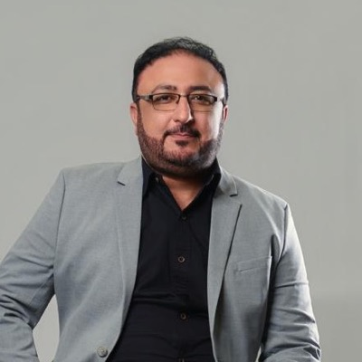

  

# 👋 Hi, I'm Wasif Ul Islam Shah

## 🧠 Senior AI Solutions Architect | Agentic AI | Azure AI | Python | Rust | PMI-CPMAI™ | PMP®

I'm an **AI Solutions Architect** with **15+ years in backend engineering**, including **4+ years building Rust and distributed systems** and a recent focus on **production agentic AI**.

I architected the agentic infrastructure behind **[myndlab.ai](https://myndlab.ai)**, a prompt-to-full-stack app builder, and built **[FacilityOps AI](https://github.com/wasif1024/facilityops)**, an open-source enterprise agentic system on **Microsoft Foundry** with guardrails, PII protection, evaluation gates and human-in-the-loop control.

I'm **PMP®** and **PMI-CPMAI™** certified, bringing structured delivery and AI governance to enterprise AI initiatives, with a strong blockchain background across **Solana** and **Substrate**.

---

## 🤖 Featured AI Projects

### 🏢 **[FacilityOps AI](https://github.com/wasif1024/facilityops)** — Enterprise agentic AI on Microsoft Foundry
> AI-powered facility maintenance intake combining agentic AI, deterministic safety controls, PII protection and human-in-the-loop workflows

  

70-second walkthrough of the running app (synthetic data).

- Built a **multimodal maintenance-intake system** (text, photo, voice, scanned documents in English, Spanish and French) on **Microsoft Foundry** and **Microsoft Agent Framework**, using Azure OpenAI, AI Vision, Speech, Document Intelligence and Translator.
- Designed a **deterministic intake pipeline** with a single classifier agent and an **emergency bypass before any AI**; escalated incidents go to a **Magentic multi-agent team** (manager plus six specialist agents with read-only tools and a Foundry IQ knowledge base) that proposes **cited plans for facility-manager approval** before the application acts.
- Implemented **guardrails** (Content Safety, Prompt Shields against direct and in-document injection), **PII redaction before any model or log**, Entra ID / External ID with **deny-by-default RBAC**, and append-only audit trails.
- Built an **evaluation suite** of 108 golden cases plus an 84-case emergency holdout set, with automated quality gates in CI:

  | Metric | Result |
  |---|---|
  | Emergency recall | **1.00** |
  | Category accuracy | **0.91** |
  | Prompt-injection resistance | **1.00** |
  | Counterfactual fairness | **1.00** |

- Defined the Azure deployment as code in **Bicep** (Container Apps, Key Vault, PostgreSQL, Service Bus, monitoring), using **managed identity and no API keys**.
- **Stack:** Python, FastAPI, Connect RPC/protobuf, PostgreSQL, React/TypeScript, OpenTelemetry, Application Insights, Docker, GitHub Actions.

---

### 💼 **[Deep Sales Assistant](https://github.com/wasif1024/Deep-Sales-Assistant)** — Sandboxed AI sales agent with LangChain Deep Agents
> A step-by-step tutorial project for building a multi-agent sales assistant that runs every action inside its own cloud sandbox

  

The newsletter is researched in the background while the main agent keeps working in its sandbox.

- Built a **Deep Agent** (`create_deep_agent`) that reads quote requests from a sales rep's inbox, prices them from a real database, has the math double-checked, and **drafts the reply for human approval**.
- Designed **specialist subagents**, each with its own tools, model and memory: a database analyst, an inbox manager (via an **MCP** mail server), and a quote reviewer.
- Added **human-in-the-loop approvals** for risky actions (adding a customer, saving an email draft) and **skills** — step-by-step playbooks the agent loads on demand.
- Ran all generated code in a **separate LangSmith sandbox per conversation**, so charts, reports and files never touch the user's machine.
- Implemented **async subagents**: a background newsletter agent fans out parallel genre researchers (Tavily web search) while the user keeps chatting.
- **Stack:** Python, LangGraph, LangChain Deep Agents, Claude API, MCP, LangSmith (sandboxes & tracing), TypeScript chat UI.

---

## 🚀 Professional Experience

### 🧩 **AI Solutions Architect / Agentic AI Architect – Permus Software House ([myndlab.ai](https://myndlab.ai)), Dubai**
> Jan 2026 – Oct 2026 · Myndlab turns a natural-language prompt into a production-grade, containerized full-stack or mobile app across 10+ technology stacks, with native Arabic support

- **Sole architect and engineer** for the platform's agentic AI infrastructure, owning design through production for AI-driven application generation using **Rust, RIG, LLM orchestration** and cloud-native services.
- Designed **graph-driven, durable workflows** for deterministic, auditable and resumable AI execution.
- Built **MCP-compatible execution infrastructure** for controlled tool invocation, with explicit state transitions, runtime enforcement and secure execution boundaries.
- Architected **agent memory and retrieval pipelines** using vector databases and contextual execution.
- Designed orchestration layers covering **code generation, execution, validation and deployment automation** for generated apps.
- Designed microservice and event-driven architectures and applied observability practices to improve the reliability, traceability and production readiness of AI workloads.

---

### 🏢 **Senior Rust Engineer (Contract) – Astra Tech (Botim Messaging Platform), Dubai**
> Feb 2025 – Aug 2025

- Designed **high-throughput Rust and gRPC services** for Botim's large-scale real-time messaging infrastructure.
- Built **event-driven backend pipelines** handling presence, coordination and messaging flows.
- Improved performance, reliability and fault tolerance of production services.

---

### 🛠️ **Senior Rust Engineer – Taif Ul Jaud (Consulting & Product Development)**
> Apr 2023 – Feb 2025

- **Led a team of 10**, owning architecture, task planning and delivery of Rust backend and Solana systems for international clients.
- Directed backend API development and workflow orchestration in Rust and Node.js.
- **Designity**: shipped an Anchor-based Solana program for tamper-evident reviews. **Hoopas**: built Metaplex NFT contracts, launched on Magic Eden.

---

### ⚡ **Lead Rust Engineer – Invo Technology (Remote)**
> 2022 – 2023

- Designed a scalable **Rust microservices architecture** with async **Actix-Web** APIs for blockchain-integrated systems.
- Integrated **Subxt** for on-chain/off-chain communication with Substrate networks.
- Built **Kafka- and Redis-based event pipelines** deployed with Docker and Kubernetes on AWS.

---

### 🦀 **Rust Engineer – FifthTry (Remote)**
> 2021 – 2022

- Built Rust (Actix-Web) backend services with OAuth authentication (Google, Discord, Telegram).

---

### 🌐 **Earlier Career – Web Application Development**
> 2010 – 2021

- Senior Web Application Developer – Intagent (2016–2021)
- Web Application Developer – Brainiacs Technologies (2010–2016)

---

## 💰 Solana DeFi Protocols (Personal Projects, 2025)

Four Anchor programs built in **Rust + Anchor**:

- **[WS Lending](https://github.com/wasif1024/ws-lending)** — over-collateralized lending protocol with interest accrual and liquidations.
- **[WS Stablecoin](https://github.com/wasif1024/ws-stablecoin)** — SOL-backed CDP stablecoin with oracle-based (Pyth) health factors.
- **[WS Swap](https://github.com/wasif1024/ws-swap)** — token swap with PDA-secured vaults.
- **WS Vesting** — PDA-based vesting with cliff logic on Token-2022.

---

## 🛠️ Core Skills

### **AI & Agentic AI**
Microsoft Foundry • Microsoft Agent Framework • Azure OpenAI • Azure AI Content Safety & Prompt Shields • Azure AI Vision, Speech, Document Intelligence, Translator • Azure AI Search • Magentic Multi-Agent Orchestration • Semantic Kernel • LangGraph • LangChain • RIG • MCP • Claude API • RAG • Multi-Agent Systems • AI Evaluation • AI Guardrails • Responsible AI

### **Backend & Infrastructure**
Rust • Python • FastAPI • Tokio • Axum • Actix-Web • gRPC / Connect RPC • PostgreSQL • Redis • Temporal • Qdrant • Kafka • Microservices • Event-Driven Architecture

### **Cloud & DevOps**
Microsoft Azure • Microsoft Entra ID • Application Insights • AWS • Docker • Kubernetes • Bicep / Infrastructure as Code • GitHub Actions • CI/CD • OpenTelemetry

### **Blockchain**
Solana • Anchor • Token-2022 • Metaplex • Substrate • Polkadot SDK • Subxt • Risc0 zkVM • Cross-Chain Interoperability

---

## 🎓 Certifications

- **Project Management Professional (PMP®)** — Project Management Institute, 2026
- **PMI Certified Professional in Managing AI (PMI-CPMAI™)** — Project Management Institute, 2026
- **Investment Foundations® Certificate** — CFA Institute
- **Polkadot Blockchain Academy (PBA-X)**, Wave 5
- **Certified Solana Builder** — HackQuest × Solana Foundation

## 📚 Courses

- **Anthropic (2026):** Claude with the Anthropic API • Introduction to Model Context Protocol (MCP) • Claude Code in Action • Introduction to Agent Skills

---

## 📫 Get In Touch

- **LinkedIn**: [Wasif Ul Islam Shah](https://www.linkedin.com/in/wasif-shah-13002799/)
- **GitHub**: [@wasif1024](https://github.com/wasif1024)
- **Email**: wasif1024@gmail.com
- **WhatsApp**: +92 345 476 7257
- **Location**: Pakistan

I'm always open to discussing **agentic AI architecture, enterprise AI on Azure, AI governance, and production-grade backend systems**. Let's build something reliable together. 🚀
